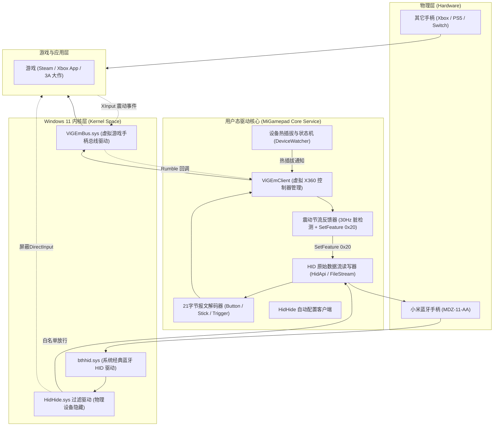

# 小米蓝牙手柄 Windows 11 XInput 虚拟驱动技术设计方案

本方案旨在为**小米蓝牙手柄（型号：MDZ-11-AA）**提供现代 Windows 11 环境下的原生 Xbox 360 控制器（XInput）接入支持，彻底解决原生 DirectInput 游戏兼容差、缺少震动反馈、蓝牙休眠断连，以及与其他手柄共存时的“幽灵手柄/按键双发”问题。

---

## 一、系统整体架构



---

## 二、通信协议逆向与报文格式

### 1. 设备基本参数
* **Vendor ID (VID)**: `0x2717` (Xiaomi)
* **Product ID (PID)**: `0x3144`
* **蓝牙芯片**: Broadcom BCM20730 (Bluetooth 3.0 HID Profile)

### 2. 输入报告 (Input Report, 长度 21 字节)
每当手柄产生按键动作、扳机按压或摇杆位移，系统会收到 21 字节的原始数据包：

| 字节偏移 (Offset) | 字段名称 | 取值范围 | 说明 |
| :--- | :--- | :--- | :--- |
| **Byte 0** | Report ID | 固定 `0x04` | 输入报文标识 |
| **Byte 1** | Buttons 1 | 位掩码 | Bit 0: A, Bit 1: B, Bit 3: X, Bit 4: Y, Bit 6: LB, Bit 7: RB |
| **Byte 2** | Buttons 2 | 位掩码 | Bit 2: Back, Bit 3: Start, Bit 5: LS(L3), Bit 6: RS(R3) |
| **Byte 3** | Reserved | `0x00` | 保留位 |
| **Byte 4** | D-Pad (Hat) | `0~7, 15` | 十字键 (0=上, 1=右上, 2=右, 3=右下, 4=下, 5=左下, 6=左, 7=左上, 15=松开) |
| **Byte 5** | Left Stick X | `0x00 ~ 0xFF` | 左摇杆水平轴（中心约 `128`） |
| **Byte 6** | Left Stick Y | `0x00 ~ 0xFF` | 左摇杆垂直轴（HID 原生 0=顶，需反转为 XInput 标准） |
| **Byte 7** | Right Stick X | `0x00 ~ 0xFF` | 右摇杆水平轴（中心约 `128`） |
| **Byte 8** | Right Stick Y | `0x00 ~ 0xFF` | 右摇杆垂直轴（HID 原生 0=顶，需反转为 XInput 标准） |
| **Byte 9~10** | Reserved | `0x00` | 保留位 |
| **Byte 11** | Left Trigger (LT) | `0x00 ~ 0xFF` | 线性左扳机（松开 `0`，压到底 `255`） |
| **Byte 12** | Right Trigger (RT)| `0x00 ~ 0xFF` | 线性右扳机（松开 `0`，压到底 `255`） |
| **Byte 13~18**| Accelerometer | 3 × Int16 LE | 内置 3 轴重力传感器原始数据 (X, Y, Z) |
| **Byte 19** | Battery Level | `0 ~ 100` | 电池电量百分比 |
| **Byte 20** | Special Buttons | 位掩码 | Bit 0: MI 徽标键 (映射为 Xbox Guide 键 / Xbox Game Bar) |

### 3. 震动特征包 (SetFeature Report, 长度 3 字节)
通过调用 Windows HID 的 `HidD_SetFeature` 向手柄下发马达控制指令：
```text
[0x20] [Small Motor Strength (0x00-0xFF)] [Big Motor Strength (0x00-0xFF)]
```
* **Byte 0**: `0x20`（小米手柄专属震动指令 ID）
* **Byte 1**: 右侧弱震马达（高频细震）强度
* **Byte 2**: 左侧强震马达（低频重震）强度

---

## 三、核心模块与关键机制设计

### 1. 解决双重输入冲突（HidHide 自动化隐藏）
* **原理**：利用 `Nefarius.Drivers.HidHide` 提供的 IOCTL 控制接口。
* **流程**：
  1. 启动驱动服务时，获取自身进程名与可执行文件路径，加入白名单。
  2. 枚举匹配 `HID\VID_2717&PID_3144`，将其加入 HidHide 的阻止列表（Blocked List）。
  3. 此时所有普通应用程序（Steam、各类游戏进程）无法再读取到物理手柄发出的 DirectInput 信号，只有白名单中的本驱动可以正常读写。
  4. 游戏仅能看到虚拟出的 Xbox 360 控制器，从根本上解决按键双发与多手柄混用混乱。

### 2. 多手柄共存与 XInput 动态槽位分配
* 用户同时使用多个小米手柄，或者同时连接原生 Xbox One 手柄时：
  * **唯一设备标识**：通过 Windows 提供的设备实例路径（Device Path 中包含蓝牙物理地址）对每个物理手柄单独实例化。
  * **虚拟手柄动态管理**：每个物理连接对应一个独立的 `IXbox360Controller` 实例。手柄物理断开（关机/休眠）时立即调用 `Disconnect()` 释放 XInput 槽位，手柄重新连入时自动申请空闲槽位（Slot 1~4）。

### 3. 震动回传节流与保护机制 (Rumble Rate Limiter)
* 游戏调用 XInput 震动时，频率往往超过 100Hz。
* **节流器算法**：
  * 限制更新频率为 30Hz（即两次下发最小间隔 33ms）。
  * 脏数据检查：如果当前震动数值与上一帧相同，不重复下发，避免蓝牙信道拥塞导致通信卡顿与断连。
  * 3 秒无更新超时保护：若马达持续震动超过 3 秒没有新指令更新，自动停止震动保护电机与手柄电量。

### 4. 摇杆非线性校准与死区保护
* 针对老化手柄摇杆物理漂移，引入可调节的死区半径：
  $$\Delta X = X_{raw} - 128, \quad \Delta Y = Y_{raw} - 128$$
  当绝对位移在死区半径以内时输出 0，超出部分平滑映射到 `[-32768, 32767]`。
